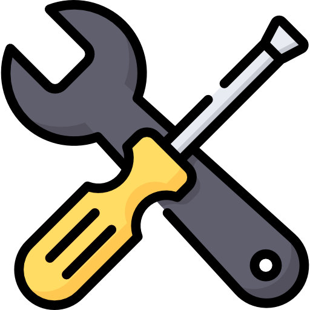
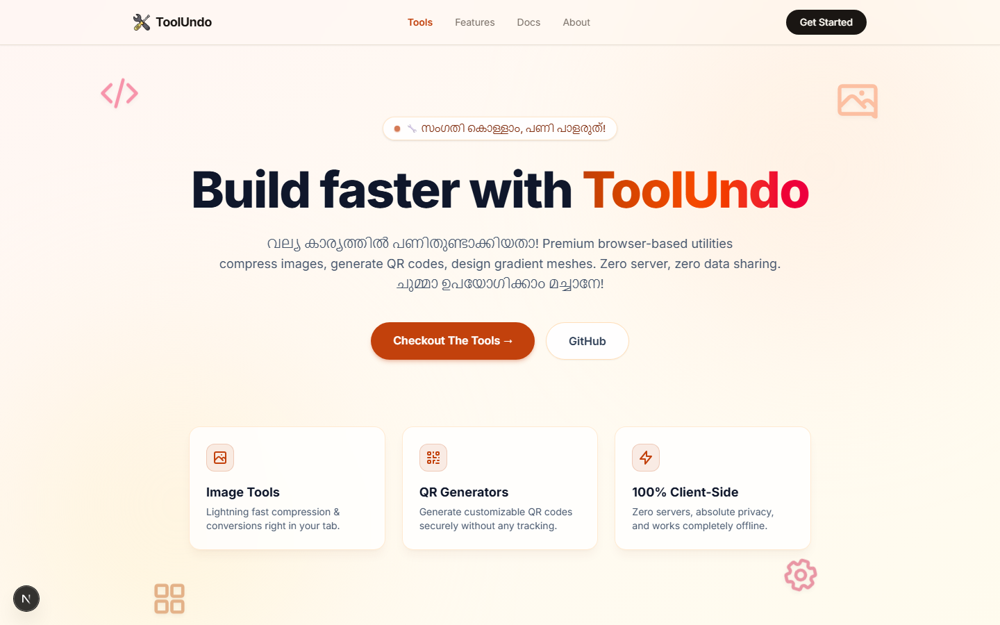
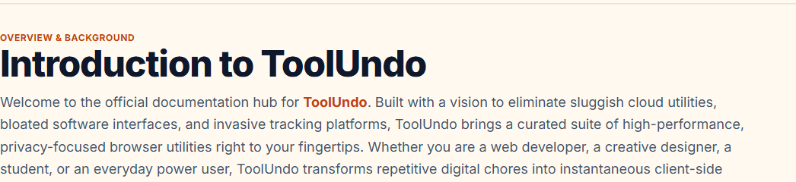

<p align="center">
  
</p>

<div align="center">

# 🛠️ ToolUndo — Browser-Based Developer Tools

_"നമ്മുടെ സ്വന്തം Tooling Companion!" (Our very own Tooling Companion!)_

**Free · Private · Blazing fast. A suite of everyday utilities that run 100% in your browser — zero uploads, zero tracking, zero setup.**


</div>

---

## 🔍 Preview

<!-- Page loads instantly server-rendered; a playful 5-second splash hides only
     after hydration, so the demo below shows the real rendered app. -->


<div align="center">

| Real-time QR Generator                                                              | Built-in Documentation                                   |
| ----------------------------------------------------------------------------------- | -------------------------------------------------------- |
|  |  |

</div>

> 💡 **Tip:** want a GIF demo instead of static shots? Record ~10s with any screen recorder (or [LICEcap](https://www.cockos.com/licecap/)) and save it as `public/screenshots/demo.gif`, then add:
> ```markdown
> 
> ```

## ✨ Features

| Tool                                                            | What it does                                                                                        |
| --------------------------------------------------------------- | --------------------------------------------------------------------------------------------------- |
| 🖼️ **Image → WebP**                                             | Compress & convert PNG / JPG / GIF / BMP / SVG to WebP with live preview — no uploads, fully private. |
| 🔳 **QR Generator**                                             | Custom colors, size, margin & 4 error-correction levels. High-res PNG export + one-click copy.       |
| 🎨 **CSS Mesh Gradient**                                        | Drag multi-point color nodes and copy pure CSS for modern mesh gradients.                            |
| 📄 **JPG → PDF**                                                | Turn images into page-sized share-ready PDFs with lossless embedding, built entirely client-side.    |
| 🎵 **YouTube → MP3**                                            | Extract audio from any YouTube video or Short via a lightweight Next.js API route.                   |

**And across the whole app:**

- ⚡ **Dynamic SSR** — every route is server-rendered on demand (Next.js App Router: `ƒ (Dynamic)`)
- 🧩 **RSC architecture** — server components for all static UI, small client islands only where interactivity demands it (modals, canvas, uploads, accordions)
- 🔒 **Privacy-first** — images, PDFs and QR payloads never leave the device; conversions run on Canvas/File APIs
- 📈 **SEO complete** — per-route metadata with canonical URLs, dynamic `sitemap.xml` + `robots.txt`, JSON-LD structured data (`WebSite`, `ItemList`, `FAQPage`), and on-the-fly Open Graph images via `next/og`
- 🧭 Scroll-aware header with mobile drawer, AOS-driven animations, dark docs mode

## 🧱 Tech Stack

| Layer      | Tech                                                        |
| ---------- | ----------------------------------------------------------- |
| Framework  | [Next.js](https://nextjs.org) 16 (App Router, Turbopack)     |
| UI         | React 19, Tailwind CSS 4, Lucide icons, AOS                  |
| Language   | TypeScript                                                   |
| Rendering  | Server Components + selective client islands (force-dynamic) |
| Media      | Canvas API (WebP/PDF), `qrcode`                              |

## 🚀 Getting Started

```bash
# 1. Clone
git clone https://github.com/abints47/tool-undo.git
cd tool-undo

# 2. Install
npm install

# 3. Develop
npm run dev        # → http://localhost:3000

# 4. Verify dynamic SSR output
npm run build && npm start
```

> 🌍 **Custom domain?** Set `NEXT_PUBLIC_SITE_URL=https://your-domain.com` so sitemap, robots and OG URLs generate with your domain.

### Production build output

```text
Route (app)
┌ ƒ /                ├ ƒ /image-to-webp
├ ƒ /docs            ├ ƒ /jpg-to-pdf
├ ƒ /api/youtube-mp3 ├ ƒ /qr-generator
├ ○ /opengraph-image ├ ○ /sitemap.xml
├ ○ /robots.txt      └ ƒ /youtube-mp3

○  (Static)  prerendered      ƒ  (Dynamic)  server-rendered on demand
```

## 📂 Project Structure

```text
src/
├── app/                 # App Router pages (all server-rendered)
│   ├── layout.tsx       # Root layout · metadata · (sitemap/robots/OG-conventions)
│   ├── page.tsx         # Home — static sections as RSC + client islands
│   ├── opengraph-image.tsx   # Dynamic 1200×630 OG image (next/og)
│   ├── sitemap.ts / robots.ts
│   ├── docs / image-to-webp / jpg-to-pdf / qr-generator / youtube-mp3
│   └── api/youtube-mp3  # Route handler (audio extraction)
├── components/
│   ├── home/            # Client islands: Toolbox, LoadingSplash
│   ├── layout/          # Header, Hero, Testimonials, Faq, Footer, AosProvider
│   ├── docs/            # DocsClient (interactive docs shell)
│   └── tools/           # Each utility's interactive UI
└── lib/                 # site config (SEO), page-metadata, faqs, converters
```

## 🗺️ Roadmap

- [ ] PWA / offline support (all tools are already 100% client-side)
- [ ] Web Worker based image processing with WASM codecs
- [ ] Batch processing + conversion history (IndexedDB)
- [ ] Rate limiting & caching for the YouTube → MP3 API

## 📜 License

Distributed under the **MIT License**.

---

<div align="center">
Made with ❤️ in Kerala, India 🌴 — by <a href="https://github.com/abints47">Abin</a>
</div>
